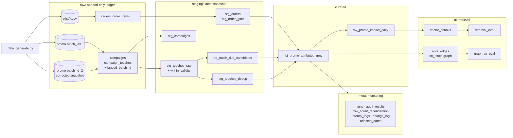
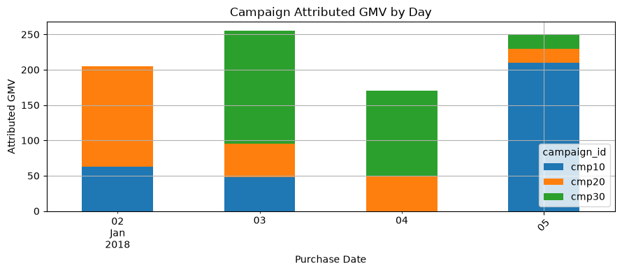

# Promo Attribution ETL: incremental builds that provably match a full rebuild

A runnable **DuckDB + Python** ETL system that attributes order revenue (GMV) to marketing campaigns and keeps it correct when the marketing data changes. When a corrected batch arrives, the pipeline **detects which purchase dates changed**, rebuilds **only those dates**, and **proves** the result is identical to a full rebuild. Every run is atomic, audited, checksummed and timed. A small retrieval layer (vector search + GraphRAG) is built on the same outputs.


[](https://github.com/akotechonline/promo-attribution-incremental-etl/actions/workflows/tests.yml)


> Final project for IS 455 (Database Design & Prototyping), improved after submission. It follows on from my midterm, [olist-promotion-impact-pipeline](https://github.com/akotechonline/olist-promotion-impact-pipeline), which measured campaign revenue on the real Olist data. This project focuses on what happens **when the data changes**. The graded version is tagged [`v1.0`](https://github.com/akotechonline/promo-attribution-incremental-etl/tree/v1.0); see [What changed in v2](#what-changed-in-v2).

---

## The problem

Marketing tools send "touch" logs: a record each time a campaign reached a customer before an order. Two things make campaign revenue unreliable:

1. **Duplicate touches.** The same touch can arrive twice with identical keys. Joining touches to order revenue then **multiplies rows**, and `SUM(revenue)` looks bigger than it is.
2. **Data that changes after the fact.** Marketing sends a first batch, then a **corrected batch**: a duplicate removed, a campaign's end date extended, and late touches added. The report must update without re-processing everything, and without ending up different from what a full rebuild would give.

## At a glance

| Question | Answer |
|---|---|
| **One row = ?** | One `(order_id, campaign_id, purchase_date)` in `curated.fct_promo_attributed_gmv` |
| **Who sees what?** | A growth or marketing analyst queries the DuckDB view `curated.vw_promo_impact_daily` (attributed GMV per day and campaign) |
| **How fresh is it?** | Rebuilt per batch (daily). The latest `SUCCESS` row in `meta.runs` shows the mode, scope and time; a failed run is marked `FAILED` and leaves the previous data in place |
| **Full vs incremental?** | Full rebuilds every layer. Augmented lands only new batches, detects the changed purchase dates, and deletes and re-inserts staging and curated rows for those dates only |
| **What is recomputed and skipped?** | Recorded per table in `meta.change_log` (`REBUILT`, `SCOPED (n dates)`, `SKIPPED`, with rows deleted and inserted) |
| **Does incremental equal full?** | Checked in every augmented run against a shadow full rebuild (audit `R3`, 0 differing rows), and by matching checksums |
| **What failures are in the data?** | A duplicate touch, a touch outside its campaign's validity window, and a corrected batch with late touches |
| **How are runtime failures caught?** | Audits in `meta.audit_results`; with `--strict-audit` any failure stops the run. Every run is one transaction, so failures roll back |

## Architecture



### Batch contract

Each promo batch folder (`data/raw/promo/batch_id=N`) is a **complete snapshot** of the marketing feed. Raw keeps every landed batch as an append-only ledger tagged with `landed_batch_id`, so history is never lost. Staging and curated always reflect the **latest** snapshot, so a correction in batch 2 replaces what batch 1 said instead of being stacked on top of it.

### Cleaning rules

**Raw → staging.** Cast types, drop rows with missing keys, keep only `delivered` orders, and keep only the latest snapshot of the promo feed. Order revenue is **pre-aggregated to one row per order** (`stg_order_gmv`) before any campaign join. Each touch is marked `within_validity` when its order's purchase date falls inside the campaign's validity window.

```sql
SELECT CAST(t.touch_id AS VARCHAR) AS touch_id, ..., o.purchase_date,
       (o.purchase_date BETWEEN c.valid_from AND c.valid_to) AS within_validity
FROM raw.campaign_touches t
JOIN staging.stg_orders o ON o.order_id = CAST(t.order_id AS VARCHAR)
LEFT JOIN staging.stg_campaigns c ON c.campaign_id = CAST(t.campaign_id AS VARCHAR)
WHERE t.landed_batch_id = 2          -- latest snapshot only
```

**Staging → curated.** Keep one touch per logical key `(order_id, campaign_id, touch_at)`, drop touches outside the validity window, then split each order's GMV equally across the distinct campaigns that touched it. Orders that had a duplicate touch carry a `dq_inflation_risk` flag.

```sql
SELECT * EXCLUDE (rn)
FROM (
  SELECT *, ROW_NUMBER() OVER (
           PARTITION BY order_id, campaign_id, touch_at
           ORDER BY touch_id) AS rn
  FROM staging.stg_touches_raw
) t
WHERE rn = 1;
```

## Update scenario

Campaign metadata and touch logs arrive in **daily batches** from external marketing tools; a new batch landing triggers a run. Batch 1 is the first landing. Batch 2 is a **corrected snapshot**:

- the duplicate touch `t108` is removed;
- campaign `cmp20`'s end date moves from 4 to 5 January, so touch `t109` (5 January) starts to count;
- two **late touches** arrive: `t200` and `t201`.

### How the augmented build works

1. **Land only what's new.** Batches already in `raw` are skipped, so re-running is harmless.
2. **Detect changed dates.** Compare the new snapshot with the previous one: touches removed or corrected, touches added, and campaigns whose validity window changed. Each change maps to the purchase dates it affects (`meta.affected_dates`). For this batch it finds **3 January** (touch removed), **4 January** (late touch) and **5 January** (validity change and late touch).
3. **Rebuild only those dates.** Delete and re-insert the touch tables and the fact table for those dates. Order tables are skipped because order data didn't change. 2 January is left alone.
4. **Prove it.** Build a shadow full rebuild in the same run and compare it with the incremental result (`R3_augmented_matches_full_rebuild`). Also check that the detected dates cover the sender's own `affected_window_manifest.csv` (`R4`).

`--date-start` and `--date-end` are still accepted to force a manual window.

### Results of the demo sequence

| # | Run | Scope | Curated rows | Attributed GMV | Curated checksum |
|---|---|---|---:|---:|---|
| 1 | Full, batch 1 | ALL | 8 | 790.0 | `98765beac87f…` |
| 2 | Augmented, batch 2 | 3 detected dates | 11 | 880.0 | `052ac0e91573…` |
| 3 | Full, batch 2 | ALL | 11 | 880.0 | `052ac0e91573…` |
| 4 | Full, batch 2 (repeat) | ALL | 11 | 880.0 | `052ac0e91573…` |

- **Incremental equals full.** The augmented run (2) has the **same checksum** as the full rebuilds (3, 4), and R3 found **0 differing rows**.
- **Idempotent.** Runs 3 and 4 match on every staging and curated table.
- **The corrections show up.** Late touches add order `o1006` (R$ 50) and `o1007` (R$ 40). Because `cmp20` is now valid on 5 January, `o1007`'s GMV is split R$ 20 / R$ 20 between `cmp20` and `cmp30`.

What the augmented run recomputed (`meta.change_log`):

| Table | Action | Deleted | Inserted |
|---|---|---:|---:|
| `raw.campaigns`, `raw.campaign_touches` | Appended batch 2 | 0 | 3 / 11 |
| `staging.stg_orders`, `stg_order_items`, `stg_order_gmv` | **Skipped** (order data unchanged) | 0 | 0 |
| `staging.stg_campaigns` | Rebuilt (3-row dimension) | – | – |
| `staging.stg_touches_raw` | Scoped to 3 dates | 7 | 8 |
| `staging.stg_touches_dedup` | Scoped to 3 dates | 6 | 8 |
| `curated.fct_promo_attributed_gmv` | Scoped to 3 dates | 5 | 8 |



## Failure catalog

| Failure | (a) How it gets into the data | (b) Where it is detected | (c) What curated and the analyst see |
|---|---|---|---|
| **Duplicate touch** | `data_generate.py` puts `t108`, an exact logical copy of `t105` (order `o1004`), in batch 1 | `staging.dq_touch_dup_candidates`; audit `C2` (1 in the batch 1 run) | The duplicate is dropped before attribution, so GMV is not inflated; `o1004`'s rows carry `dq_inflation_risk = TRUE` until batch 2 removes the duplicate |
| **Touch outside validity window** | `t109` touches order `o1007` on 5 January, while `cmp20` is valid only to 4 January in batch 1 | `within_validity` in staging; audit `C4` (1 in the batch 1 run) | Excluded from attribution. When batch 2 extends `cmp20`, the change is detected and `t109` starts to count |
| **Corrected and late-arriving batch** | Batch 2 removes `t108`, extends `cmp20`, and adds `t200` and `t201` | Snapshot diff into `meta.affected_dates`; checked against the sender's manifest (`R4`) | Only the 3 affected dates are rebuilt; the result matches a full rebuild (`R3`) |
| **Broken campaign dates** | A campaign arrives with a blank or reversed validity window (tested in `tests/`) | Audit `C5_campaign_validity_window_valid` | With `--strict-audit` the run fails and rolls back; without it, the campaign's touches are excluded and the failure is visible in `meta.audit_results` |
| **Runtime failure** | A missing batch file, or any failed audit with `--strict-audit` | The exception, `meta.audit_results`, and `meta.runs.status = 'FAILED'` | The run's transaction is rolled back, so analysts keep seeing the last good data, and the failed run is visible in `meta.runs` |

## Monitoring artifacts

| Table | What it records |
|---|---|
| `meta.runs` | One row per build: mode, scope, start/finish time, status (`RUNNING`, `SUCCESS`, `FAILED`, `SUPERSEDED`), curated rows, audit failures |
| `meta.audit_results` | Named checks per run: null keys (C1), duplicates found (C2), grain uniqueness (C3), touches outside validity (C4), missing or reversed campaign dates (C5), GMV over-allocation (R1), lost keys (R2), augmented equals full (R3), manifest coverage (R4), retrieval quality |
| `meta.row_count_reconciliation` | Row count and MD5 checksum of key tables per run, for idempotency and incremental-vs-full proofs |
| `meta.change_log` | Per table and run: rebuilt, scoped or skipped, with rows deleted, inserted and after |
| `meta.affected_dates` | The purchase dates an augmented run rebuilt, and why |
| `meta.latency_logs` | Milliseconds spent in each stage |

## Design trade-offs

- **Equal-split attribution.** GMV is split equally across the distinct campaigns that touched an order on its purchase date. This is transparent and easy to audit, because the parts always add back up to the order total. The cost is accuracy: it ignores touch order and timing, so it can under-credit the campaign that actually closed the sale compared with a model-based multi-touch method.
- **Scope by purchase date.** Rebuilding by date keeps incremental logic simple and auditable. The cost is granularity: one changed touch rebuilds every order on that day, which is fine at daily volume but coarser than order-level upserts.
- **Shadow verification.** Running a full rebuild inside each augmented run proves correctness, at the cost of doing the full work anyway. At this data size that's negligible. At scale you'd sample dates or verify nightly instead of on every run.

## Retrieval layer: vector search and GraphRAG

- **Chunks:** one per campaign, built from staging and curated outputs (name, channel, attributed GMV), with a 256-dimension **hashed bag-of-words** vector stored as `DOUBLE[]` in DuckDB. It is deterministic and needs no external model.
- **Lookup questions** ("Which campaign uses the social channel?") are answered by cosine similarity. Hit@1 is **1.0** (`ai.retrieval_eval`).
- **The graph:** `ai.note_edges` links campaigns that **reached the same orders**, weighted by how many orders they share. It is built from the curated fact table, so it updates with every batch.
- **Relationship questions** ("Which campaign most often reaches the same orders as NewYearPush?"): vector search can only return the campaign the question names, so it scores **0.0**. GraphRAG retrieves that campaign, then follows its strongest edge, and scores **1.0** (`ai.graphrag_eval`). The expected answer is computed from the fact table itself.
- **Grounding:** `ai.grounded_answers` stores the exact chunk behind each answer. `ai.agent_trace` and `ai.cost_summary` log each step.

## What changed in v2

Reviewing the submitted version, I found four weaknesses and fixed them:

| v1.0 (submitted) | v2 |
|---|---|
| Batch 2 was **stacked** on batch 1 with `UNION ALL`. Every re-sent touch looked like a duplicate, so 8 of 10 rows were flagged risky | Raw is a ledger; staging uses the **latest snapshot**. Only real duplicates are flagged, and the flag clears once the sender fixes them |
| The campaign end-date correction had **no effect**, because attribution ignored validity dates | Touches outside the validity window are excluded (audit C4); the correction now changes attribution for order `o1007` |
| The augmented build rebuilt **all of staging** and needed a **manual date window** | Changed dates are **detected from the data**; staging and curated are rebuilt for those dates only; unchanged tables are skipped and logged |
| The incremental result **differed** from a full rebuild (risk flags), and nothing checked it | Every augmented run is verified against a shadow full rebuild (R3); checksums match |
| GraphRAG had **no edges** (edges were "same channel", and each campaign has its own channel) | Edges come from campaigns reaching the same orders; GraphRAG answers relationship questions that vector search can't |
| A failed run could leave a batch **half-landed** | Each run is **one transaction**: failures roll back and are recorded as `FAILED` |
| No tests | **10 end-to-end tests** (`pytest`), plus a new check for blank or reversed campaign dates (C5) |

`data_generate.py` gained one touch (`t109`) so the validity correction has a visible effect.

## Repository structure

```
.
├── build.py              # Pipeline: --mode full | augmented, change detection, audits, monitoring, AI layer
├── data_generate.py      # Synthetic Olist-style orders plus promo batches 1 and 2
├── run_demo.sh           # Replays the four-run demo from a clean warehouse
├── final_report.ipynb    # Full report: layers, charts, failure story, incremental proof, AI evidence
├── tests/                # End-to-end tests (pytest)
├── data/raw/             # Generated input files (small; regenerate with data_generate.py)
├── assets/               # Chart used in this README
└── requirements.txt
```

`data/processed/warehouse.duckdb` is created when you run the pipeline and isn't stored in the repository.

## Run it yourself

```bash
git clone https://github.com/akotechonline/promo-attribution-incremental-etl.git
cd promo-attribution-incremental-etl
python -m venv .venv
source .venv/bin/activate          # Windows: .venv\Scripts\activate
pip install -r requirements.txt

./run_demo.sh                      # generate data and run all four builds
python -m pytest -q                # 10 end-to-end tests
jupyter notebook final_report.ipynb
```

On Windows, run the demo steps one by one:

```bash
python data_generate.py --root .
python build.py --root . --mode full --promo-max-batch 1
python build.py --root . --mode augmented --promo-max-batch 2
python build.py --root . --mode full --promo-max-batch 2
python build.py --root . --mode full --promo-max-batch 2
```

Options: `--strict-audit` fails the run on any failed check, `--skip-ai` skips the retrieval layer, and `--date-start`/`--date-end` force a manual window for an augmented build.

See what the incremental run did:

```bash
python -c "import duckdb; c=duckdb.connect('data/processed/warehouse.duckdb', read_only=True); print(c.sql('SELECT table_name, action, rows_deleted, rows_inserted FROM meta.change_log WHERE run_id = (SELECT run_id FROM meta.runs WHERE mode = \'augmented\')'))"
```

## Limits

- The data is **small and synthetic** (8 orders, 3 campaigns), so every number can be checked by hand. The SQL doesn't depend on the data size.
- The embeddings are hashed word counts, not a trained model. That's enough for exact names and keywords; questions phrased with synonyms would need a real embedding model.

## Skills demonstrated

- **Incremental ETL:** change detection by snapshot diff, date-scoped delete-and-insert, and skip logic
- **Correctness proofs:** shadow full rebuild comparison, checksum reconciliation and idempotency checks
- **Reliability:** atomic runs with rollback, a run registry with stale-run handling, and fail-fast audits
- **Data modelling:** layered raw/staging/curated design with a declared fact grain and a reporting view
- **Data quality:** duplicate detection, validity-window enforcement, over-allocation and lost-key reconciliation
- **Testing:** end-to-end pytest suite covering idempotency, incremental equality, corrections and failure rollback
- **Retrieval:** a vector store in DuckDB, Hit@1 evaluation, a co-occurrence graph and grounded answers
- **Critical review:** finding the weaknesses in my own submitted design and fixing them

## About this project

Final project for **IS 455 – Database Design & Prototyping** (Spring 2026). The brief required a DuckDB + Python ETL system with full and incremental builds, a live update event, monitoring artifacts, a failure catalog, a documented trade-off, and an idempotency proof. The submitted version is preserved at tag [`v1.0`](https://github.com/akotechonline/promo-attribution-incremental-etl/tree/v1.0).

## License

Code: MIT License (see [`LICENSE`](LICENSE)). The data is synthetic and generated by `data_generate.py`.

## Author

**Rasheed Akorede Adigun** · [GitHub @akotechonline](https://github.com/akotechonline)
