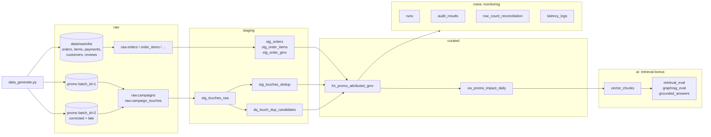
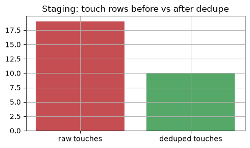

# Promo Attribution ETL: full and incremental builds with built-in monitoring

A runnable **DuckDB + Python** ETL system that attributes order revenue (GMV) to marketing campaigns, handles a **corrected second batch** of marketing data with an **incremental (augmented) rebuild**, and records every run's quality checks, checksums and timings so the output can be trusted. It also includes a small retrieval layer (vector search + GraphRAG) built on the same pipeline outputs.


> This is the final project for IS 455 (Database Design & Prototyping). It follows on from my midterm, [olist-promotion-impact-pipeline](https://github.com/akotechonline/olist-promotion-impact-pipeline), which measured campaign revenue on the real Olist data. This project focuses on what happens **when the data changes**.

---

## The problem

Marketing tools send "touch" logs: a record each time a campaign reached a customer before an order. Two things make campaign revenue unreliable:

1. **Duplicate touches.** The same touch can arrive twice with identical keys. Joining touches to order revenue then **multiplies rows**, and `SUM(revenue)` looks bigger than it is.
2. **Data that changes after the fact.** Marketing sends a first batch, then a **corrected batch**: duplicates removed, a campaign's end date extended, and late touches added. The report has to update without re-processing everything and without mixing old and new logic.

## What the system does

| Question the brief asks | Answer in this project |
|---|---|
| **One row = ?** | One `(order_id, campaign_id, purchase_date)` in `curated.fct_promo_attributed_gmv` |
| **Who sees what?** | A growth or marketing analyst queries the DuckDB view `curated.vw_promo_impact_daily` (attributed GMV per day and campaign) |
| **How fresh is it?** | Rebuilt per batch (daily). The latest successful row in `meta.runs` shows the mode, scope, time and status, so stale or partial updates are visible |
| **Full vs incremental?** | Full mode rebuilds every layer. Augmented mode deletes and recomputes only the curated rows in an affected purchase-date window |
| **What failures are in the data?** | Injected duplicate touches and a corrected batch with late-arriving touches (see the failure catalog below) |
| **How are runtime failures caught?** | Each run writes PASS/FAIL checks to `meta.audit_results`; `--strict-audit` stops the run and marks it `FAILED` in `meta.runs` |

## Architecture



### Layers and cleaning rules

**Raw → staging.** Cast types, drop rows with missing keys, and keep only `delivered` orders. Order revenue is **pre-aggregated to one row per order** (`stg_order_gmv`) before any campaign join. Duplicate touches are **detected** (`dq_touch_dup_candidates`) and **removed** (`stg_touches_dedup`).

```sql
CREATE OR REPLACE TABLE staging.stg_orders AS
SELECT CAST(order_id AS VARCHAR) AS order_id,
       CAST(order_purchase_timestamp AS TIMESTAMP) AS order_purchase_ts,
       CAST(order_purchase_timestamp AS DATE) AS purchase_date
FROM raw.orders
WHERE order_id IS NOT NULL AND order_status = 'delivered';
```

**Staging → curated.** Keep one touch per logical key `(order_id, campaign_id, touch_at)`, then split each order's GMV equally across the distinct campaigns that touched it. Orders that had duplicate touches carry a `dq_inflation_risk` flag.

```sql
SELECT *
FROM (
  SELECT *, ROW_NUMBER() OVER (
           PARTITION BY order_id, campaign_id, touch_at
           ORDER BY touch_id) AS rn
  FROM staging.stg_touches_raw
) t
WHERE rn = 1;
```



## Update scenario and build modes

Campaign metadata and touch logs arrive in **daily batches** from external marketing tools. Batch 1 is the first landing. Batch 2 is a **correction** for 3–5 January 2018: the duplicate touch `t108` is removed, campaign `cmp20`'s end date moves from 4 to 5 January, and two **late touches** (`t200`, `t201`) arrive. A new batch landing triggers a run.

| Mode | Command | What it recomputes | What it leaves alone |
|---|---|---|---|
| **Full** | `--mode full` | Every raw, staging and curated table (`CREATE OR REPLACE`) | Nothing |
| **Augmented** | `--mode augmented --date-start … --date-end …` | Curated rows inside the purchase-date window (`DELETE` + `INSERT`) | Curated rows outside the window |

**Avoiding double counting:** touches are de-duplicated on their logical key before the join, and order GMV is aggregated before it meets campaigns, so the sum of attributed GMV for an order can never exceed the order's real GMV (audit `R1`).

**Superseding stale runs:** each run gets a millisecond `run_id`. When a new run starts, any run still marked `RUNNING` is set to `SUPERSEDED`.

### Results of the demo sequence

| # | Run | Scope | Curated rows | Attributed GMV | Curated checksum |
|---|---|---|---:|---:|---|
| 1 | Full, batch 1 | ALL | 8 | 790.0 | `98765beac87f…` |
| 2 | Augmented, batch 2 | 2018-01-03 to 2018-01-05 | 10 | 880.0 | `d5ade80b0d3d…` |
| 3 | Full, batch 2 | ALL | 10 | 880.0 | `7029c3fd9852…` |
| 4 | Full, batch 2 (repeat) | ALL | 10 | 880.0 | `7029c3fd9852…` |

- Runs 3 and 4 have the **same checksum** on every staging and curated table, which is the idempotency proof the brief asks for.
- The late touches add **2 rows and R$ 90** of attributed GMV (orders `o1006` and `o1007`).
- The augmented run (2) produces the **same rows and GMV** as the full rebuild (3). Its checksum differs only because of the `dq_inflation_risk` flag on three rows outside the window; see the limitations below.


## Failure catalog

| Failure | (a) How it gets into the data | (b) Where it is detected | (c) What curated and the analyst see |
|---|---|---|---|
| **Duplicate promotional touch** | `data_generate.py` injects `t108`, an exact logical copy of `t105` (order `o1004`, campaign `cmp20`, same timestamp) in batch 1 | `staging.dq_touch_dup_candidates`; counted by audit `C2_duplicate_touch_detection` | The duplicate is dropped before attribution, so GMV is not inflated; affected rows carry `dq_inflation_risk = TRUE` |
| **Corrected and late-arriving batch** | Batch 2 removes `t108`, extends `cmp20`'s end date, and adds late touches `t200` and `t201` | Run scope in `meta.runs` and the row-count/checksum change in `meta.row_count_reconciliation` | The augmented build recomputes only 3–5 January; new rows appear for `o1006` and `o1007` |
| **Runtime audit failure** | Any check returning `FAIL` (null keys, duplicate grain, over-allocated GMV, lost keys) | `meta.audit_results` | With `--strict-audit` the run stops and `meta.runs.status = 'FAILED'`, so analysts can see the view wasn't refreshed |

## Monitoring artifacts

| Table | What it records |
|---|---|
| `meta.runs` | One row per build: mode, scope, start/finish time, status, curated row count, audit failures |
| `meta.audit_results` | Named checks per run with PASS/FAIL and a metric (null keys, grain uniqueness, GMV over-allocation, lost keys, retrieval quality) |
| `meta.row_count_reconciliation` | Row count and MD5 checksum of each key table per run, used to verify idempotency |
| `meta.latency_logs` | Milliseconds spent in each stage (raw load, staging, curated, audit, AI) |

## Design trade-off

GMV is **split equally** across the distinct campaigns that touched an order on its purchase date. This is transparent, deterministic and easy to audit, since the parts always add back up to the order total. The cost is accuracy: it ignores touch order and timing, so it can under-credit the campaign that actually closed the sale compared with a model-based multi-touch method.

## Retrieval bonus: vector search and GraphRAG

- **`ai.vector_chunks`:** one text chunk per campaign, built from staging and curated outputs (name, channel, attributed GMV), with a 64-dimension **hashed bag-of-words** vector stored as `DOUBLE[]` in DuckDB.
- **Retrieval:** cosine similarity between the question and each chunk. `ai.retrieval_eval` scores Hit@1 on three test questions (1.0 on this data).
- **GraphRAG:** `ai.note_edges` links campaigns that share a channel, and `ai.graphrag_eval` scores a one-hop boosted ranking next to plain vector search.
- **Grounding and monitoring:** `ai.grounded_answers` stores the exact chunk behind each answer. `ai.agent_trace` and `ai.cost_summary` log each retrieval step.

## Known limitations and next steps

Reviewing the project after submission, these are the things I'd improve:

1. **Batches are stacked, not replaced.** `--promo-max-batch 2` reads batch 1 *and* batch 2 with `UNION ALL`, and batch 2 re-sends every earlier touch. De-duplication keeps the GMV correct, but almost every touch then looks like a duplicate, so the full rebuild flags 8 of 10 rows as risky instead of just order `o1004`. The fix is to keep the latest version of each `touch_id` and `campaign_id` (`ROW_NUMBER() … ORDER BY source_batch_id DESC`) before the logical de-duplication.
2. **Campaign validity isn't used yet.** Batch 2 extends `cmp20` to 5 January, but attribution doesn't read `valid_from`/`valid_to`, so that correction has no effect on the numbers.
3. **Staging isn't scoped.** Augmented mode limits the curated step to the date window but still rebuilds all staging tables.
4. **GraphRAG has no edges on this data.** Each campaign uses a different channel, so `ai.note_edges` is empty and GraphRAG returns the same answers as vector search. The embeddings are also hashed word counts, not a trained embedding model.
5. **The data is small and synthetic** (8 orders, 3 campaigns) so every effect can be checked by hand. The same SQL runs unchanged on larger data.

## Repository structure

```
.
├── build.py              # Pipeline entry point: --mode full | augmented, audits, monitoring, AI layer
├── data_generate.py      # Generates the synthetic Olist-style data and promo batches 1 and 2
├── run_demo.sh           # Replays the four-run demo from a clean warehouse
├── final_report.ipynb    # Full report: every layer, charts, failure story, idempotency, AI evidence
├── data/raw/             # Generated input files (small; regenerate with data_generate.py)
├── assets/               # Charts used in this README
└── requirements.txt
```

`data/processed/warehouse.duckdb` is created when you run the pipeline and isn't stored in the repository.

## Run it yourself

```bash
git clone https://github.com/akotechonline/promo-attribution-incremental-etl.git
cd promo-attribution-incremental-etl
python -m venv .venv
source .venv/bin/activate          # Windows: .venv\Scripts\activate
pip install -r requirements.txt

./run_demo.sh                      # macOS / Linux: generate data and run all four builds
jupyter notebook final_report.ipynb
```

On Windows, run the four commands from `run_demo.sh` one by one:

```bash
python data_generate.py --root .
python build.py --root . --mode full --promo-max-batch 1
python build.py --root . --mode augmented --promo-max-batch 2 --date-start 2018-01-03 --date-end 2018-01-05
python build.py --root . --mode full --promo-max-batch 2
python build.py --root . --mode full --promo-max-batch 2
```

Other options: `--strict-audit` fails the run on any failed check, and `--skip-ai` skips the retrieval layer.

Inspect the monitoring tables directly:

```bash
python -c "import duckdb; c=duckdb.connect('data/processed/warehouse.duckdb'); print(c.sql('SELECT mode, scope, status, rows_curated, audit_failures FROM meta.runs ORDER BY started_at_ms'))"
```

## Skills demonstrated

- **Incremental ETL:** full and windowed (delete-and-insert) rebuild modes on DuckDB
- **Data modelling:** layered raw/staging/curated design with a declared fact grain and a reporting view
- **Join safety:** pre-aggregation and window-function de-duplication to prevent row multiplication
- **Observability:** run registry, audit results, checksum reconciliation and stage latency logs
- **Idempotency proof:** checksum comparison across repeated full rebuilds
- **Retrieval:** a vector store inside DuckDB, Hit@1 evaluation, grounding and provenance tables, and a GraphRAG ranking
- **Critical review:** documenting where the design falls short and how to fix it

## About this project

Final project for **IS 455 – Database Design & Prototyping** (Spring 2026). The brief required a DuckDB + Python ETL system with full and incremental builds, a live update event, monitoring artifacts, a failure catalog, a documented trade-off, and an idempotency proof.

For this portfolio version I re-ran the whole pipeline and notebook on a clean machine, added `run_demo.sh`, fixed a few details in this README, and added a short comparison of the incremental and full builds at the end of the notebook. `build.py` and `data_generate.py` are unchanged from the submission.

## License

Code: MIT License (see [`LICENSE`](LICENSE)). The data is synthetic and generated by `data_generate.py`.

## Author

**Rasheed Akorede Adigun** · [GitHub @akotechonline](https://github.com/akotechonline)
